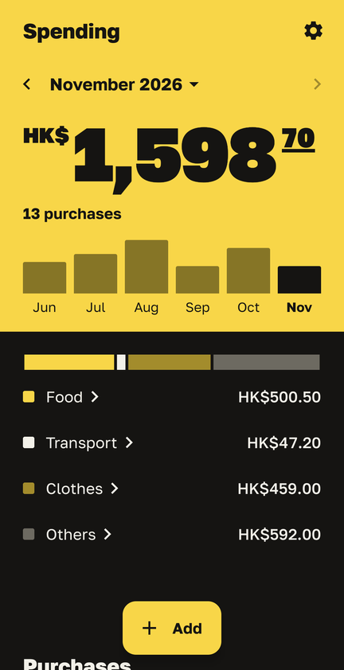
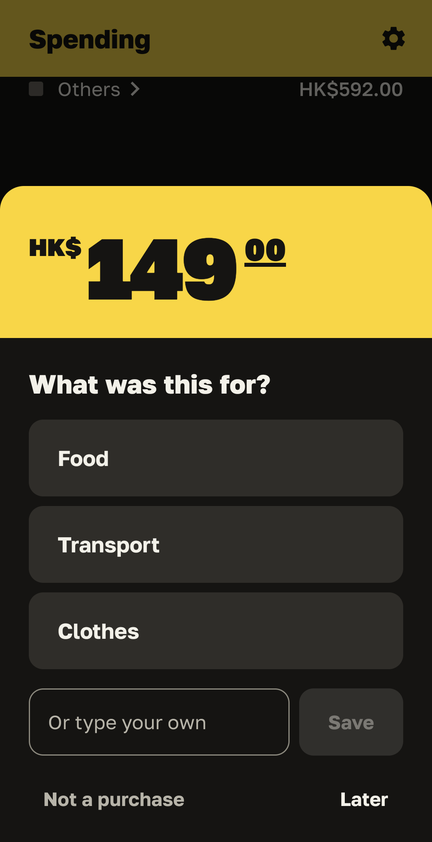
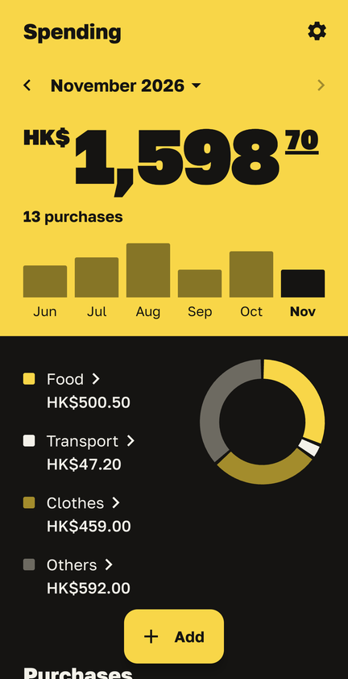
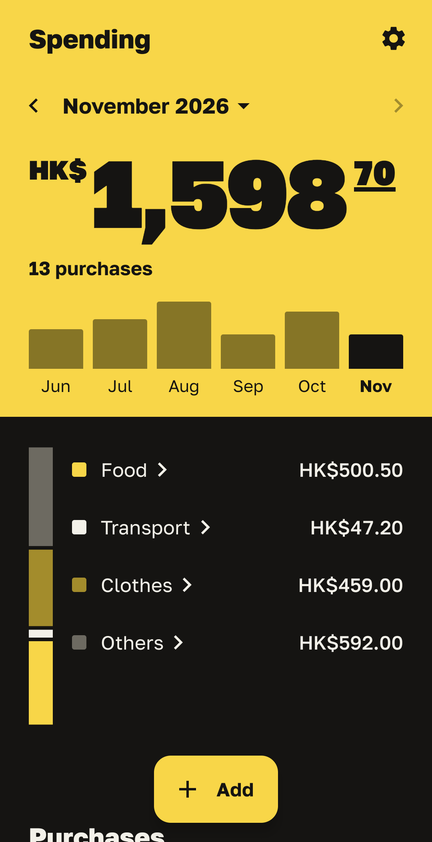
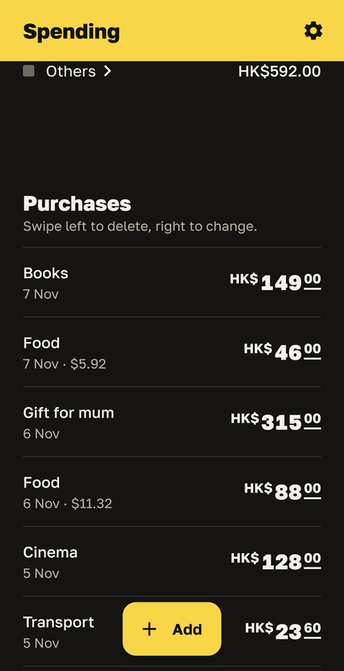
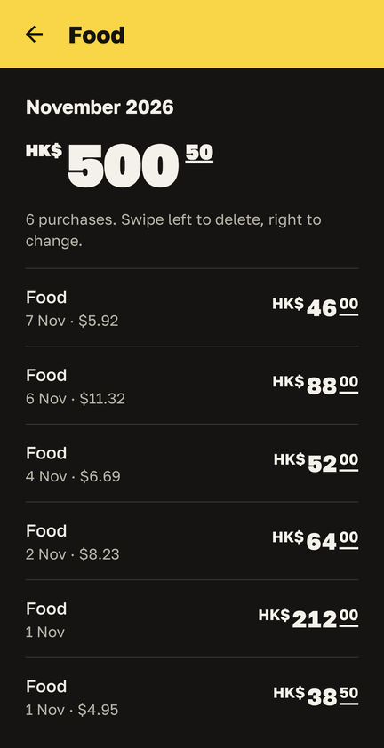
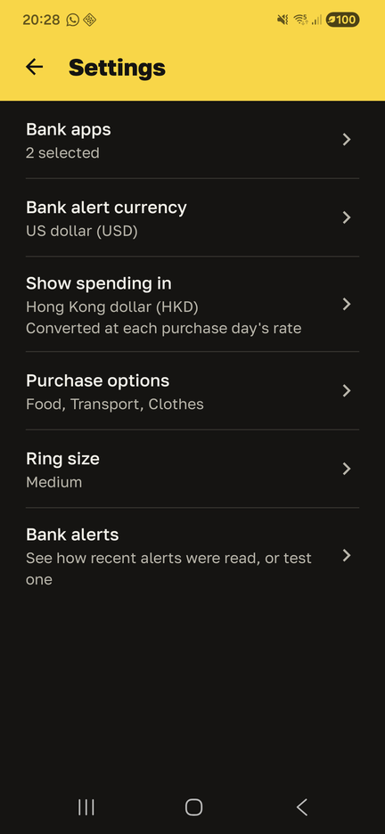

# Spend Tracker

**An Android app that logs your card spending on its own, by reading your bank's notifications. Nothing leaves your phone.**

<p>
  
  
  
</p>

<sub>Screenshots use demo purchases.</sub>

## Why I made this

Most of my friends track their spending by typing every purchase into an app or a notes page. Everyone gives up after a week or two, because you have to remember to do it every single time.

But the phone already knows. Every time I pay, my bank sends a notification with the amount. So I thought: why type anything at all? Spend Tracker reads that notification, saves the purchase, and asks one quick question: **what was this for?** One tap, and you're done.

## What it does

- **Logs purchases automatically.** When a bank alert arrives, the app pulls the amount out of it and saves it. It understands formats like Freedom Bank's and HSBC Hong Kong's. It ignores things that aren't spending, like cashback, refunds, money coming in, verification codes and ads.
- **Asks what it was for, right after you pay.** A small pop-up offers your three most common reasons (Food, Transport, Clothes, or your own), a box to type something else, or "Not a purchase". You can also answer later.
- **Works across currencies.** My card is in US dollars, but I live with Hong Kong dollars. Each purchase is converted at **that day's** exchange rate and kept that way, so last month's totals don't shift when rates change. It supports KZT, USD, HKD and SGD.
- **Shows where the money went.** The month's total is a big price tag, with bars for the last six months. Below it, a spending line is split by category. **Swipe it right and it rolls into a ring; swipe it left and it becomes a column.**
- **Lets you dig in.** Tap a category to see every purchase in it. Anything that isn't one of your three main reasons goes into "Others", which has its own page. Pick any date range from the calendar.
- **Is easy to fix.** Swipe a purchase right to change it, or left to delete it, with a confirmation first.

<p>
  
  
  
  
</p>

## Your data stays on your phone

Spend Tracker has no account, no server and no cloud backup. Purchases are stored in a small database on the phone, and Android's backup is turned off for it. The only time the app goes online is to download exchange rates. That request contains nothing about you or your spending.

It only reads notifications from the apps you choose (your bank), and it doesn't keep anything else.

## How it works

1. **Listening.** A `NotificationListenerService` receives notifications. Everything from apps you haven't picked is ignored straight away.
2. **Reading the amount.** `AmountParser` finds the spending amount in the alert text. This was the trickiest part: bank alerts mix in the remaining balance, card numbers, dates and cashback, and banks write numbers differently, like `1,234.50` or `5 000,00 ₸`. It's covered by unit tests built from real alert formats.
3. **Converting.** If the purchase isn't in your display currency, the app converts it at today's rate and saves both amounts.
4. **Asking.** A notification and a pop-up window ask what the purchase was for.
5. **Showing.** The Home screen is built with Jetpack Compose. The chart is drawn by hand on a `Canvas`: the line, the ring and the column are one shape that bends as you swipe, rather than three separate charts.

## Built with

- Kotlin and Jetpack Compose (Material 3)
- SQLite for storage
- Android's notification listener
- Exchange rates from [ExchangeRate-API](https://www.exchangerate-api.com)
- [Golos Text](https://github.com/googlefonts/golos-text) font
- No third-party libraries beyond Android's own (AndroidX)

There are 52 unit tests, mostly for reading amounts out of bank alerts and for the money maths.

## Design

The look is called **Shelf Tag**: the month's total is drawn like a yellow price tag on a shop shelf, in loud yellow and ink. Most finance apps look calm and blue; I wanted this one to feel like a receipt you can't ignore. The full design system (colours, type, spacing, motion rules) is written down in [DESIGN.md](DESIGN.md), and who the app is for is in [PRODUCT.md](PRODUCT.md).

## What I learned

- **iPhone can't do this.** iOS doesn't let apps read other apps' notifications, so the core idea only works on Android. The closest iPhone version would use Apple Pay's Shortcuts automation, which only sees Apple Pay payments.
- **Wallets can count twice.** If you pay with Alipay or Google Wallet using your bank card, the bank *and* the wallet both send an alert. Rather than guessing which alerts are duplicates, the app tells you to pick only the app that actually takes your money.
- **Debug builds lie about speed.** My animations looked choppy until I learned that Compose runs much slower in a debug build. The optimised release build is smooth.
- **Small details take the longest.** Getting the chart to bend smoothly from a line into a ring, while the text slides out of its way and the list below stays perfectly still, took more attempts than everything else put together.

## Limitations

- **Android only** (8.0 or newer), for the reason above.
- It's tested with **Freedom Bank** (my bank) and **HSBC Hong Kong** alert formats. Other banks' wording may need small parser changes. You can paste any alert text into *Settings → Bank alerts → Test* to see how it would be read.
- **Prepaid wallets** like Octopus or a topped-up Alipay balance spend from money already loaded, so your bank only sees the top-up, not each purchase.

## Try it

You'll need Android Studio, or the Android SDK and JDK 17.

```sh
git clone https://github.com/Imanzhussip/spend-tracker.git
cd spend-tracker
./gradlew assembleRelease
adb install app/build/outputs/apk/release/app-release.apk
```

Open the app and follow the setup steps: allow notification access, pick your bank's app and its currency, and allow the pop-up. Then just pay for something.

## How I built it

I came up with the idea, decided how every screen should look and behave, and tested it day to day with real purchases on my own phone. I wrote the code together with an AI coding assistant (Claude Code). I described what I wanted, reviewed what it built, and kept changing things until they felt right.

## Credits

- Exchange rates: [Rates By Exchange Rate API](https://www.exchangerate-api.com)
- Font: Golos Text by The Golos Text Project Authors, under the [SIL Open Font License](app/src/main/assets/licenses/OFL-GolosText.txt)
